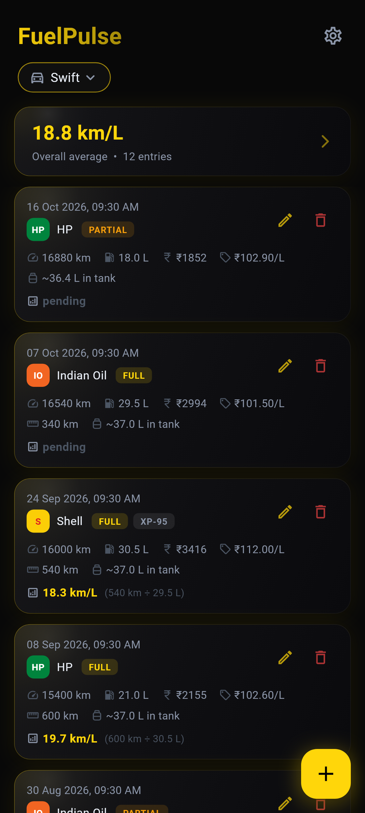
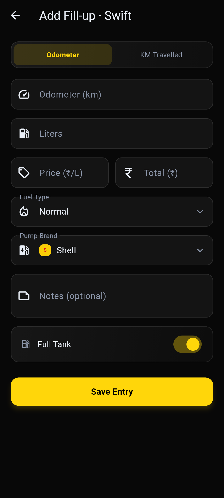
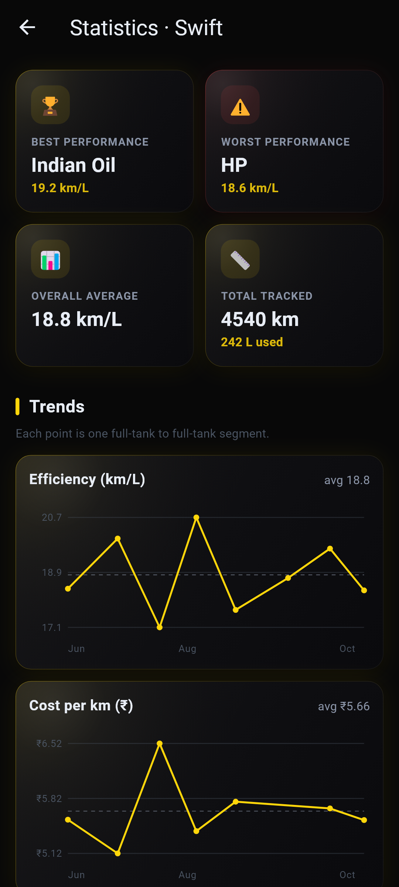
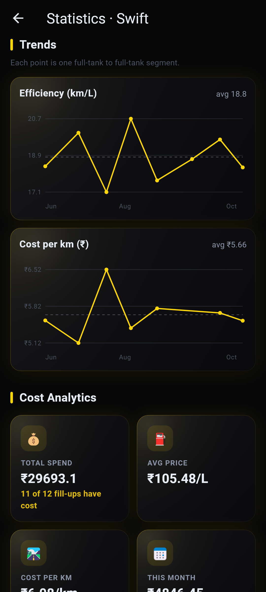
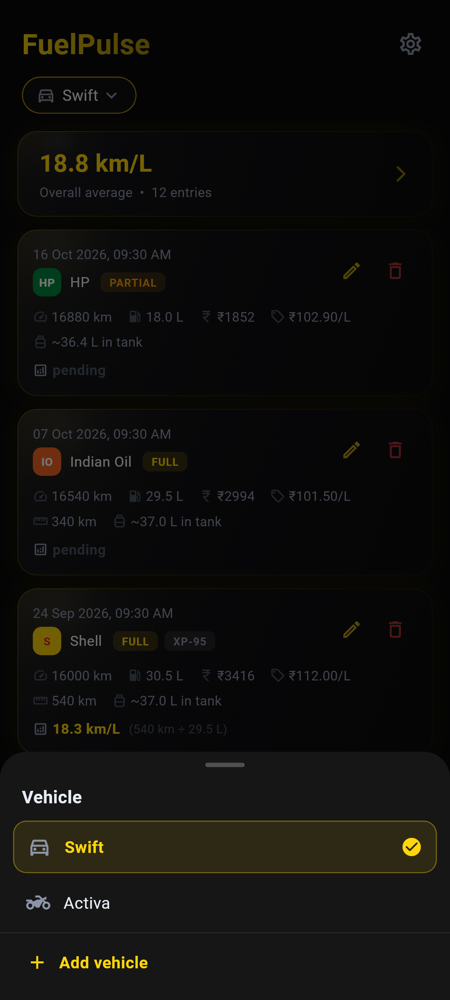

# ⛽ FuelPulse

**Offline fuel fill-up tracker with segment-based km/L efficiency analysis and brand comparison.**

[](https://flutter.dev)
[](https://dart.dev)
[](LICENSE)
[]()
[](https://github.com/santhoshunt/fuelpulse/releases/latest)

---

## Overview

FuelPulse records every fuel fill-up and works out **real-world mileage** for each full-tank segment, for each of your vehicles. It compares pump brands and fuel types, tracks what you spend, and estimates how much fuel is left in the tank. Your data lives in a SQLite database on the phone and needs no account or internet connection. Google Drive backup is optional and off until you sign in.

## Features

| Feature | Description |
|---|---|
| **Multiple vehicles** | Track a car, a bike and anything else side by side. Each vehicle has its own fill-ups, statistics, trend charts and tank size; switch with the chip under the title |
| **In-app updates** | Checks GitHub once a day and offers new versions. It downloads the APK for your phone's processor and installs it only if it is FuelPulse, signed with the same key and newer |
| **Segment-based efficiency** | Calculates km/L between consecutive full-tank entries — shows the exact *"X km ÷ Y L"* breakdown |
| **Brand comparison** | Ranks fuel brands by average efficiency with visual bars and delta indicators |
| **Fuel types** | Tag each fill-up with a fuel type. Normal is built in, and you can add others such as XP-95. Statistics compares km/L and ₹/km per type |
| **Cost tracking** | Enter the price per litre or the total paid and the app fills in the other. Statistics shows total spend, average price, cost per km and monthly spend |
| **Trend charts** | km/L and cost per km for each full-tank segment, plotted over time |
| **Pump brand management** | Add, rename and remove pump brands. A rename updates every past fill-up |
| **Tank level estimation** | Forward-walk model estimates remaining litres at each fill-up |
| **Full / Partial fill tracking** | Handles both full-tank and partial-fill entries correctly |
| **CSV import / export** | Export or import the current vehicle's fill-ups as CSV |
| **Backup file** | Export one compressed file with every vehicle, its fill-ups, fuel types, pump brands and settings, and restore it on any phone |
| **Google Drive backup** | Optional daily, weekly or monthly upload of the same backup file. The app can only see files it created in your Drive |
| **Custom brand colours** | Assign a colour to each fuel brand for quick visual identification |
| **Dark glossy UI** | Performant CustomPaint-based glossy card design — no BackdropFilter overhead |
| **Smooth transitions** | Fade + slide page routes, scroll-aware staggered list animations |
| **Offline-first** | SQLite local database — works without internet |

## Screenshots

| Home | Add fill-up |
|---|---|
|  |  |
| **Statistics** | **Trends** |
|  |  |
| **Vehicles** | |
|  | |

The screenshots come from sample data rendered offscreen. To regenerate them, run:

```bash
flutter test tool/readme_screenshots_test.dart --update-goldens
```

## Tech Stack

- **Framework:** Flutter (Dart)
- **Database:** SQLite via [sqflite](https://pub.dev/packages/sqflite)
- **State management:** StatefulWidget + setState (lightweight, no external state library)
- **Preferences:** [shared_preferences](https://pub.dev/packages/shared_preferences)
- **CSV:** [csv](https://pub.dev/packages/csv) + [share_plus](https://pub.dev/packages/share_plus)
- **Backup:** [file_picker](https://pub.dev/packages/file_picker) for restore, [google_sign_in](https://pub.dev/packages/google_sign_in) + [googleapis](https://pub.dev/packages/googleapis) for Drive
- **Charts:** drawn with `CustomPaint`, no chart package
- **Updates:** [http](https://pub.dev/packages/http) for the GitHub release check and download, a Kotlin `PackageInstaller` bridge for the install, [url_launcher](https://pub.dev/packages/url_launcher) for the release page
- **Theming:** Custom `ThemeManager` with dynamic brand colours via [flutter_colorpicker](https://pub.dev/packages/flutter_colorpicker)

## Project Structure

```
lib/
├── main.dart                  # App entry, theme setup, DB init
├── db/
│   └── database_helper.dart   # SQLite CRUD operations
├── models/
│   ├── fuel_log.dart          # FuelLog data model
│   ├── vehicle.dart           # Vehicle data model
│   └── theme_preference.dart  # Theme/colour preferences model
├── screens/
│   ├── home_screen.dart       # Main log list + summary banner
│   ├── entry_form_screen.dart # Add or edit a fill-up
│   ├── stats_screen.dart      # Stat cards, trends, cost, rankings
│   ├── settings_screen.dart   # Settings, one section per file below
│   └── settings/              # Vehicles, lists, data, Drive, theme, about, danger zone
├── services/
│   ├── backup_payload.dart    # Build and restore the backup contents
│   ├── backup_codec.dart      # Gzip encode/decode of the backup
│   ├── backup_file.dart       # Export/import the backup as a file
│   ├── drive_backup_service.dart # Scheduled Google Drive backup
│   ├── update_service.dart    # GitHub release check
│   ├── update_downloader.dart # Checked APK download
│   ├── update_installer.dart  # Bridge to the Kotlin installer
│   └── update_prefs.dart      # Update check settings
├── utils/
│   ├── efficiency_calculator.dart  # Segment-based km/L, brand and fuel type ranking
│   ├── trend_calculator.dart       # One km/L and ₹/km point per segment
│   ├── cost_calculator.dart        # Price/total sync and spend stats
│   ├── tank_level_calculator.dart  # Estimated fuel-in-tank model
│   ├── fuel_type_manager.dart      # Fuel type list (add, rename, delete)
│   ├── pump_brand_manager.dart     # Pump brand list (add, rename, delete)
│   ├── vehicle_manager.dart        # Active vehicle
│   ├── csv_helper.dart             # CSV import/export
│   ├── page_routes.dart            # Smooth fade+slide transitions
│   ├── theme_manager.dart          # Dynamic theme/colour manager
│   └── constants.dart              # App-wide constants
└── widgets/
    ├── glossy_card.dart        # CustomPaint glossy card container
    ├── fuel_log_tile.dart      # Individual log entry tile
    ├── stat_card.dart          # Summary statistic card
    ├── rank_tile.dart          # Brand / fuel type ranking row
    ├── trend_chart.dart        # CustomPaint line chart
    ├── brand_badge.dart        # Colour-coded brand chip
    ├── fuel_gauge.dart         # Fuel gauge visual
    ├── color_swatch_picker.dart # Brand colour picker
    ├── option_picker.dart      # Bottom-sheet picker for type and brand
    ├── add_fuel_type_dialog.dart # Name dialog for a new type or brand
    ├── vehicle_chip.dart       # Home screen vehicle switcher
    ├── vehicle_picker.dart     # Vehicle picker sheet and edit dialog
    ├── update_banner.dart      # Update available card
    ├── update_sheet.dart       # Version picker, download and install
    └── mode_switch.dart        # Odometer / KM travelled toggle
```

## Download

Pre-built Android APKs are available on the [Releases](https://github.com/santhoshunt/fuelpulse/releases/latest) page. From v2.0.0 on, the app finds and installs updates itself, so this is only needed once.

### Which APK do I need?

- **arm64-v8a**: almost every Android phone. Pick this one if unsure.
- **armeabi-v7a**: phones from before about 2017 that the arm64 file will not install on.
- **x86_64**: emulators and Intel-based devices only. Phones show "App not installed" for it.

Not sure? Try arm64-v8a first. If Android says the app can't be installed, use armeabi-v7a.

Backup files made by v2.0.0 or later carry vehicles. Restore them only in v2.0.0 or later: an older FuelPulse loads the fill-ups but drops which vehicle each belongs to.

On v1.0.0 or v1.1.0? Those builds were signed with a different key, so Android will not install a newer version over them. Export a backup in Settings, uninstall, install the new APK, then import the backup.

| APK | Architecture | Notes |
|---|---|---|
| [app-arm64-v8a-release.apk](https://github.com/santhoshunt/fuelpulse/releases/latest/download/app-arm64-v8a-release.apk) | ARM64 | Most modern Android phones (recommended) |
| [app-armeabi-v7a-release.apk](https://github.com/santhoshunt/fuelpulse/releases/latest/download/app-armeabi-v7a-release.apk) | ARMv7 | Older 32-bit Android phones |
| [app-x86_64-release.apk](https://github.com/santhoshunt/fuelpulse/releases/latest/download/app-x86_64-release.apk) | x86_64 | Emulators / Intel-based devices |

## Getting Started

### Prerequisites

- [Flutter SDK](https://docs.flutter.dev/get-started/install) ≥ 3.11
- Android Studio / VS Code with Flutter extension
- An Android/iOS device or emulator

### Install & Run

```bash
# Clone the repository
git clone https://github.com/santhoshunt/fuelpulse.git
cd fuelpulse

# Install dependencies
flutter pub get

# Run on connected device / emulator
flutter run
```

### Build Release APK

```bash
flutter build apk --split-per-abi
```

The ARM64 APK will be at:
```
build/app/outputs/flutter-apk/app-arm64-v8a-release.apk
```

## How Efficiency Is Calculated

FuelPulse uses **segment-based calculation** between consecutive full-tank entries:

1. A *segment* starts when you fill the tank to FULL.
2. It ends at the **next** FULL fill-up.
3. **Efficiency = distance driven in segment ÷ litres pumped at the closing fill-up.**
4. Partial fills within a segment are accumulated into the closing total.

This gives you the truest real-world mileage per fuel brand.

## Contributing

Contributions are welcome! Please open an issue first to discuss what you'd like to change.

1. Fork the repo
2. Create your feature branch (`git checkout -b feature/amazing-feature`)
3. Commit your changes (`git commit -m 'Add amazing feature'`)
4. Push to the branch (`git push origin feature/amazing-feature`)
5. Open a Pull Request

## License

This project is licensed under the **GNU General Public License v3.0** — see the [LICENSE](LICENSE) file for details.

---

<p align="center">
  Built with ❤️ and Flutter
</p>
