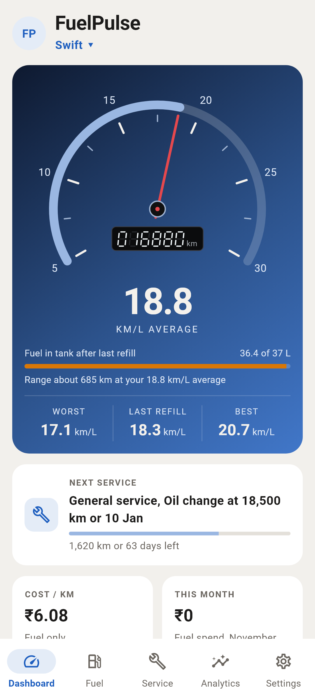
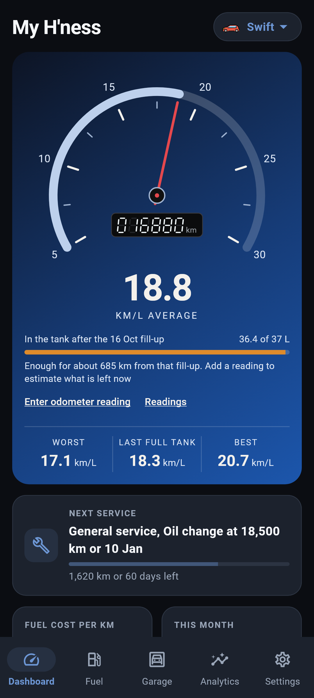
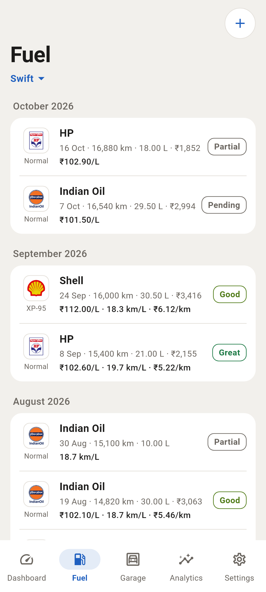
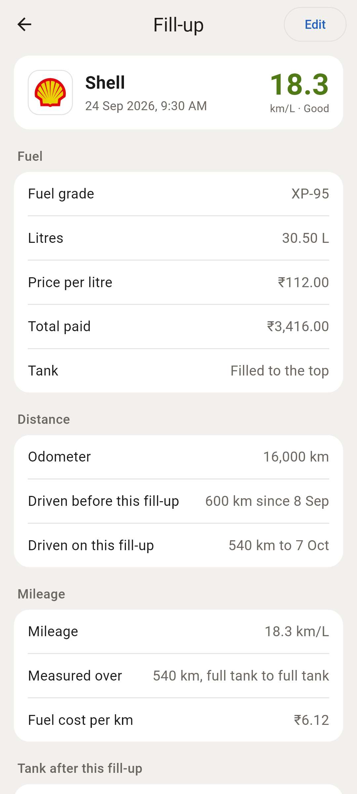
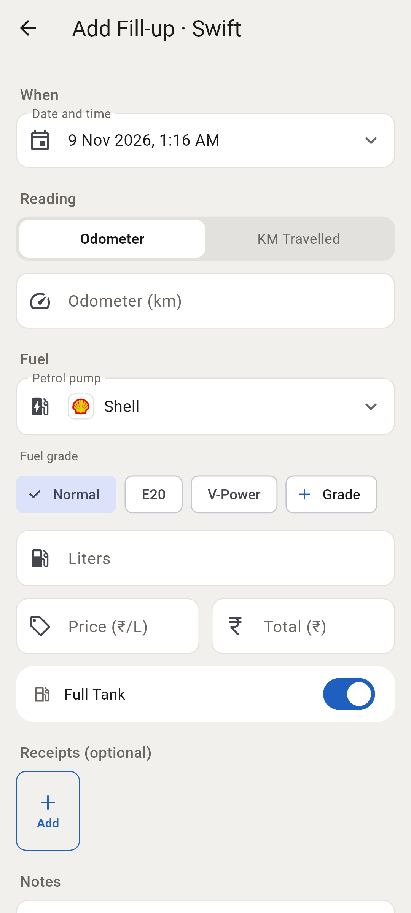
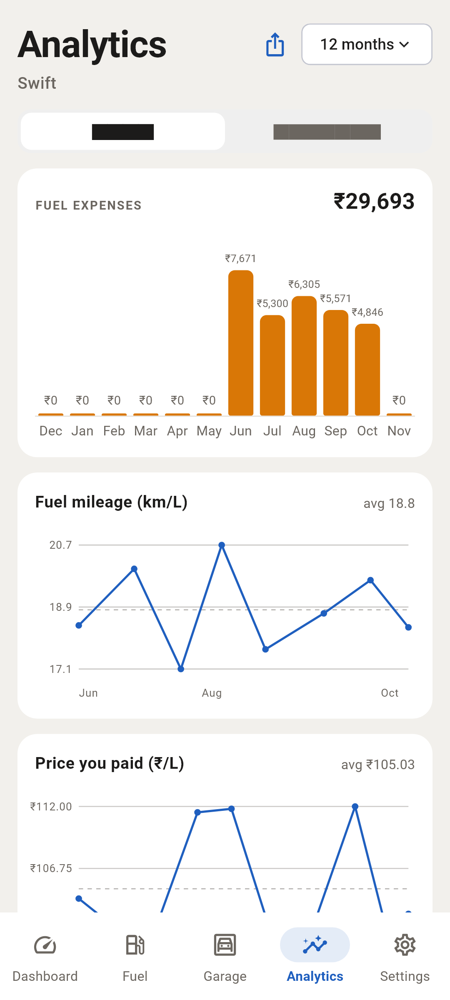
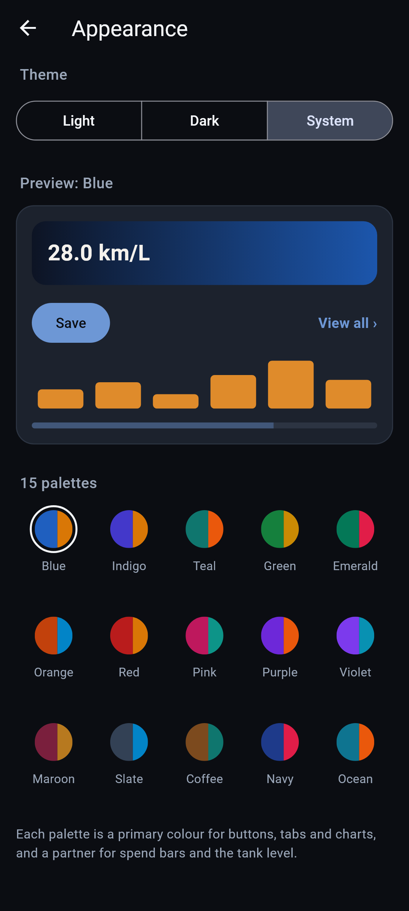

# ⛽ FuelPulse

**Offline fuel fill-up tracker with segment-based km/L efficiency analysis and brand comparison.**

[](https://flutter.dev)
[](https://dart.dev)
[](LICENSE)
[]()
[](https://github.com/santhoshunt/fuelpulse/releases/latest)

---

## Overview

FuelPulse records every fuel fill-up and works out **real-world mileage** for each full-tank segment, for each of your vehicles. It compares pump brands and fuel types, tracks what you spend, and estimates how much fuel is left in the tank. Your data lives in a SQLite database on the phone and needs no account or internet connection. Google Drive backup is optional and off until you sign in.

## Features

| Feature | Description |
|---|---|
| **Dashboard** | A speedometer-style gauge with the needle on your average km/L, the odometer on a seven-segment display, fuel left after the last refill with the range it gives, worst, last and best km/L, spend tiles and the last 12 segments' mileage |
| **Multiple vehicles** | Track a car, a bike and anything else side by side. Each vehicle has its own fill-ups, analytics and tank size; switch by tapping the vehicle name on the Dashboard or Fuel tab |
| **In-app updates** | Checks GitHub once a day and offers new versions. It downloads the APK for your phone's processor and installs it only if it is FuelPulse, signed with the same key and newer |
| **Segment-based efficiency** | Calculates km/L between consecutive full-tank entries — shows the exact *"X km ÷ Y L"* breakdown |
| **Fuel list and refill detail** | Fill-ups grouped by month with the brand logo, grade and km/L coloured from Poor to Great. Tap one to see distance, cost per km and the tank after it; swipe to delete |
| **Analytics** | Monthly fuel spend, mileage over time, brand and fuel grade comparisons and totals. Each chart has its own period: 1, 3, 6 or 12 months |
| **Brand comparison** | Ranks fuel brands by average efficiency, with each brand's logo |
| **Fuel types** | Tag each fill-up with a fuel type. Normal is built in, and you can add others such as XP-95. Analytics compares km/L per type |
| **Photo scan** | Fill a fill-up from photos on the Scan photos screen: the odometer (TOTAL reading, or TRIP as km travelled) and the pump display (amount, litres and rate, kept only when litres × rate matches the amount; when they disagree, the form offers amount ÷ rate as the litres). Gallery photos also set the date. Text is read on the phone and nothing is uploaded. A Report button shares what was read, with the photo, when a scan goes wrong |
| **Cost tracking** | Enter the price per litre or the total paid and the app fills in the other. The Dashboard shows cost per km, this month's and the average monthly spend, and the latest price |
| **Date and time** | Each fill-up has an editable date and time, so a fill-up logged later lands in the right place |
| **Pump brand management** | Add, rename and remove pump brands. A rename updates every past fill-up |
| **Tank level estimation** | Forward-walk model estimates remaining litres at each fill-up |
| **Full / Partial fill tracking** | Handles both full-tank and partial-fill entries correctly |
| **CSV import / export** | Export or import the current vehicle's fill-ups as CSV |
| **Backup file** | Export one compressed file with every vehicle, its fill-ups, fuel types, pump brands and settings, and restore it on any phone |
| **Google Drive backup** | Optional daily, weekly or monthly upload of the same backup file. The app can only see files it created in your Drive |
| **Brand logos** | Shell, HP, Indian Oil, Bharat Petroleum, Nayara Energy and Jio-BP show their own logos; other brands show initials |
| **Light and dark themes** | Light, dark or follow the phone, with 15 colour palettes. Each palette pairs a primary colour with a partner colour for spend bars and the tank level |
| **Smooth transitions** | Fade + slide page routes, scroll-aware staggered list animations |
| **Offline-first** | SQLite local database — works without internet |

## Screenshots

| Dashboard | Dashboard, dark |
|---|---|
|  |  |
| **Fuel** | **Refill** |
|  |  |
| **Add fill-up** | **Analytics** |
|  |  |
| **Appearance** | |
|  | |
The screenshots come from sample data rendered offscreen. To regenerate them, run:

```bash
flutter test tool/readme_screenshots_test.dart --update-goldens
```

## Tech Stack

- **Framework:** Flutter (Dart)
- **Database:** SQLite via [sqflite](https://pub.dev/packages/sqflite)
- **State management:** StatefulWidget + setState (lightweight, no external state library)
- **Preferences:** [shared_preferences](https://pub.dev/packages/shared_preferences)
- **CSV:** [csv](https://pub.dev/packages/csv) + [share_plus](https://pub.dev/packages/share_plus)
- **Backup:** [file_picker](https://pub.dev/packages/file_picker) for restore, [google_sign_in](https://pub.dev/packages/google_sign_in) + [googleapis](https://pub.dev/packages/googleapis) for Drive
- **Photo scan:** [google_mlkit_text_recognition](https://pub.dev/packages/google_mlkit_text_recognition) for on-device text recognition, [image_picker](https://pub.dev/packages/image_picker) for the camera and gallery
- **Charts:** drawn with `CustomPaint`, no chart package
- **Updates:** [http](https://pub.dev/packages/http) for the GitHub release check and download, a Kotlin `PackageInstaller` bridge for the install, [url_launcher](https://pub.dev/packages/url_launcher) for the release page
- **Theming:** a `ThemeExtension` (`AppColors`) built from the chosen palette and light or dark mode, so screens never hard-code a colour

## Project Structure

```
lib/
├── main.dart                  # App entry, appearance load, DB init
├── db/
│   └── database_helper.dart   # SQLite CRUD operations
├── models/
│   ├── fuel_log.dart          # FuelLog data model
│   └── vehicle.dart           # Vehicle data model
├── theme/
│   ├── palettes.dart          # The 15 colour palettes
│   ├── app_colors.dart        # Colours for the chosen palette and mode
│   └── app_theme.dart         # ThemeData for light and dark
├── screens/
│   ├── app_shell.dart         # Bottom tabs, start-up backup and update check
│   ├── dashboard_screen.dart  # Gauge card, spend tiles, mileage chart
│   ├── fuel_list_screen.dart  # Fill-ups by month
│   ├── refill_detail_screen.dart # One fill-up in full
│   ├── entry_form_screen.dart # Add or edit a fill-up
│   ├── scan_photos_screen.dart # Odometer and pump photo slots
│   ├── analytics_screen.dart  # Spend, mileage, brand and grade comparisons
│   ├── settings_screen.dart   # Settings, one section per file below
│   ├── appearance_screen.dart # Theme mode and palette
│   ├── import_export_screen.dart # CSV, backup file and Drive backup
│   └── settings/              # Vehicles, lists, data, Drive, about, danger zone
├── services/
│   ├── backup_payload.dart    # Build and restore the backup contents
│   ├── backup_codec.dart      # Gzip encode/decode of the backup
│   ├── backup_file.dart       # Export/import the backup as a file
│   ├── drive_backup_service.dart # Scheduled Google Drive backup
│   ├── photo_scan.dart        # Odometer and pump photo reading, scan report
│   ├── update_service.dart    # GitHub release check
│   ├── update_downloader.dart # Checked APK download
│   ├── update_installer.dart  # Bridge to the Kotlin installer
│   └── update_prefs.dart      # Update check settings
├── utils/
│   ├── efficiency_calculator.dart  # Segment-based km/L, brand and fuel type ranking
│   ├── trend_calculator.dart       # One km/L and ₹/km point per segment
│   ├── cost_calculator.dart        # Price/total sync and spend stats
│   ├── tank_level_calculator.dart  # Estimated fuel-in-tank model
│   ├── mileage_bands.dart          # Poor to Great km/L bands and colours
│   ├── period_filter.dart          # Logs for the last N months
│   ├── appearance_prefs.dart       # Saved palette and theme mode
│   ├── fuel_type_manager.dart      # Fuel type list (add, rename, delete)
│   ├── pump_brand_manager.dart     # Pump brand list (add, rename, delete)
│   ├── vehicle_manager.dart        # Active vehicle
│   ├── csv_helper.dart             # CSV import/export
│   ├── page_routes.dart            # Smooth fade+slide transitions
│   └── constants.dart              # Brands, defaults and keys
└── widgets/
    ├── gauge_card.dart         # Dashboard gauge with needle and tank
    ├── lcd_odometer.dart       # Seven-segment odometer
    ├── trend_chart.dart        # CustomPaint line chart
    ├── month_bar_chart.dart    # Monthly spend bars
    ├── period_selector.dart    # 1M / 3M / 6M / 12M buttons
    ├── brand_logo.dart         # Bundled brand logo, initials otherwise
    ├── brand_badge.dart        # Initials badge for other brands
    ├── option_picker.dart      # Bottom-sheet picker for type and brand
    ├── add_fuel_type_dialog.dart # Name dialog for a new type or brand
    ├── vehicle_picker.dart     # Vehicle picker sheet and edit dialog
    ├── update_banner.dart      # Update available card
    ├── update_sheet.dart       # Version picker, download and install
    └── mode_switch.dart        # Odometer / KM travelled toggle
```

## Download

Pre-built Android APKs are available on the [Releases](https://github.com/santhoshunt/fuelpulse/releases/latest) page. From v2.0.0 on, the app finds and installs updates itself, so this is only needed once.

### Which APK do I need?

- **arm64-v8a**: almost every Android phone. Pick this one if unsure.
- **armeabi-v7a**: phones from before about 2017 that the arm64 file will not install on.
- **x86_64**: emulators and Intel-based devices only. Phones show "App not installed" for it.

Not sure? Try arm64-v8a first. If Android says the app can't be installed, use armeabi-v7a.

Backup files made by v2.0.0 or later carry vehicles. Restore them only in v2.0.0 or later: an older FuelPulse loads the fill-ups but drops which vehicle each belongs to.

On v1.0.0 or v1.1.0? Those builds were signed with a different key, so Android will not install a newer version over them. Export a backup in Settings, uninstall, install the new APK, then import the backup.

| APK | Architecture | Notes |
|---|---|---|
| [app-arm64-v8a-release.apk](https://github.com/santhoshunt/fuelpulse/releases/latest/download/app-arm64-v8a-release.apk) | ARM64 | Most modern Android phones (recommended) |
| [app-armeabi-v7a-release.apk](https://github.com/santhoshunt/fuelpulse/releases/latest/download/app-armeabi-v7a-release.apk) | ARMv7 | Older 32-bit Android phones |
| [app-x86_64-release.apk](https://github.com/santhoshunt/fuelpulse/releases/latest/download/app-x86_64-release.apk) | x86_64 | Emulators / Intel-based devices |

## Getting Started

### Prerequisites

- [Flutter SDK](https://docs.flutter.dev/get-started/install) ≥ 3.11
- Android Studio / VS Code with Flutter extension
- An Android/iOS device or emulator

### Install & Run

```bash
# Clone the repository
git clone https://github.com/santhoshunt/fuelpulse.git
cd fuelpulse

# Install dependencies
flutter pub get

# Run on connected device / emulator
flutter run
```

### Build Release APK

```bash
flutter build apk --split-per-abi
```

The ARM64 APK will be at:
```
build/app/outputs/flutter-apk/app-arm64-v8a-release.apk
```

## How Efficiency Is Calculated

FuelPulse uses **segment-based calculation** between consecutive full-tank entries:

1. A *segment* starts when you fill the tank to FULL.
2. It ends at the **next** FULL fill-up.
3. **Efficiency = distance driven in segment ÷ litres pumped at the closing fill-up.**
4. Partial fills within a segment are accumulated into the closing total.

This gives you the truest real-world mileage per fuel brand.

## Contributing

Contributions are welcome! Please open an issue first to discuss what you'd like to change.

1. Fork the repo
2. Create your feature branch (`git checkout -b feature/amazing-feature`)
3. Commit your changes (`git commit -m 'Add amazing feature'`)
4. Push to the branch (`git push origin feature/amazing-feature`)
5. Open a Pull Request

## License

This project is licensed under the **GNU General Public License v3.0** — see the [LICENSE](LICENSE) file for details.

---

<p align="center">
  Built with ❤️ and Flutter
</p>
